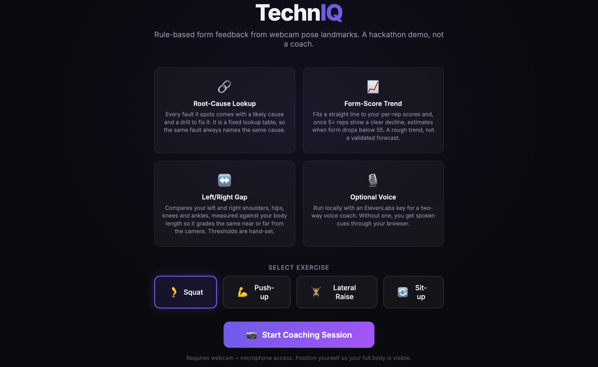

# TechnIQ

TechnIQ watches you lift through your webcam and tells you what your form is
doing wrong while you do it. It counts reps, spots faults like knees caving in or
hips sagging, and suggests the likely cause with a drill to fix it. The whole
thing runs in your browser and your video never leaves your machine.

**[Try it in the browser](https://younis-y.github.io/techniq-form-coach/)**. You'll need to allow webcam access.



I built it at UCL Zero to Demo 2025 and have kept working on it since.

## What it does

Pick a lift (squat, push-up, lateral raise or sit-up), stand back far enough that
your whole body is in frame, and press Start.

MediaPipe tracks 33 points on your body every frame, on your own device. From
those points TechnIQ works out joint angles, counts reps with a small state
machine (idle, descending, bottom, ascending) and throws away half reps.

It checks each frame against rules for the lift you picked. There are 12 fault
types across the four lifts, and the joints involved light up amber or red on the
skeleton. Each fault also maps to a likely cause and a corrective drill. When
your knees cave in on a squat, for example, it suggests weak glute medius and
gives you banded lateral walks and clamshells.

It also compares your left and right sides at the shoulders, hips, knees and
ankles, and tracks your form score rep by rep. If the score is clearly falling
over 5 or more reps, it estimates the rep where your form will drop below the
cutoff.

Cues are spoken, and a safety warning jumps ahead of encouragement in the queue.
If you run it locally with API keys you also get a two-way ElevenLabs voice coach
and a Gemini summary after each set. The hosted demo has no keys, so it uses your
browser's built-in speech instead.

## How it works

```
webcam → MediaPipe pose (33 points) → joint angles → rule checks per lift → faults
                                                  ↘ rep state machine → per-rep score → fatigue trend
                                    faults → root-cause lookup → cause + drill
```

Angles come from two `atan2` bearings at the joint (`src/angles.js`). An arccos
formula gets unstable when a limb is nearly straight, which is exactly where a
lockout sits, and `atan2` doesn't.

The fault rules live in `src/exercises.js`. Some are angles (squat depth, push-up
body line) and some are positions (how far a knee drifts inward, the gap between
shoulder and ear). A frame's score is the average of the checks that apply.

Root causes are a hand-written lookup in `src/kineticChain.js`. Most are keyed by
fault. Depth is keyed by lift too, because a shallow squat and a shallow push-up
have different causes (ankle mobility versus pressing strength). I chose a lookup
over anything clever so the same fault always gives the same answer and you can
read exactly why.

The left/right check measures the height gap as a share of your body length, from
nose to mid-ankle (`src/asymmetry.js`). The first version used raw screen
distance, so the same imbalance looked worse the closer you stood to the camera.

The fatigue trend is a straight-line fit to your per-rep scores
(`src/fatiguePredictor.js`). It only reports a crossing with at least 5 reps and
an R² of 0.5 or more. With fewer points the line is mostly noise, and the first
version happily predicted from two reps.

## Run it locally

You need Node 20 or later.

```bash
npm install
cp .env.example .env   # optional: ELEVENLABS_API_KEY, ELEVENLABS_AGENT_ID, GEMINI_API_KEY
npm run dev            # credential proxy on :8787, app on http://localhost:3000
```

The keys are optional. Without them the app still works fully: voice falls back
to browser speech and the set summary to a local template.

```bash
npm test               # 22 tests: rep counting, angles, left/right, fatigue gate, root-cause coverage
npm run build          # static build into dist/; GitHub Pages deploys it on every push to main
```

## Security

API keys stay on the server. `server/index.js` holds them, and the page only ever
talks to these four endpoints:

| Endpoint | Purpose |
|---|---|
| `GET /api/config` | which features are switched on (true/false, never the keys) |
| `POST /api/tts` | ElevenLabs text to speech, approved voices only |
| `POST /api/coach` | Gemini set summary |
| `GET /api/agent-url` | signed WebSocket URL for the private voice agent |

The proxy caps request sizes (500 characters for speech, 4,000 for a prompt,
64 KB per request) and returns short error messages, so nobody can use it as a
free relay or run up a big bill. An earlier version sent keys from the browser,
and the one key that ended up in this repo's history has been revoked. If you put
the proxy on the open internet, add authentication in front of it.

## Limits

The thresholds are my own estimates from the hackathon. Nobody has checked them
against motion capture, a coach, or a range of body types and camera angles.

It works in 2D, with one person and one camera, so results depend on standing
side-on or front-on the way each lift expects.

The fatigue estimate is a straight line with a quality check. It is not validated
against real fatigue.

The tests check the logic. There's no dataset of real lifters to measure accuracy
against.

## Health disclaimer

This is a demo, not medical, physiotherapy or coaching advice. It can't see the
weight, pain or past injuries, and "injury risk" in the interface is a label on an
arbitrary score cutoff. Don't use it to decide whether a set is safe. If something
hurts, stop and see a professional.

## Licence

MIT (see `LICENSE`). Sources for the biomechanics notes are in
`knowledge/biomechanics.md`.
